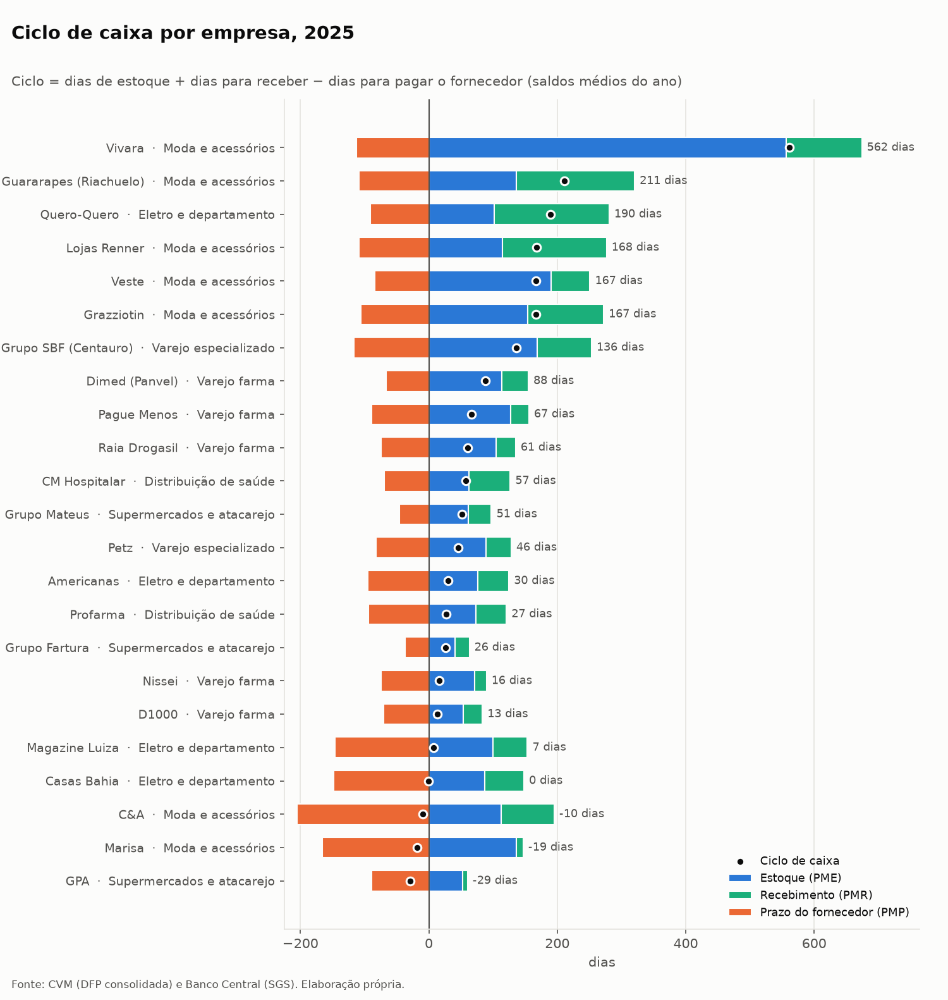
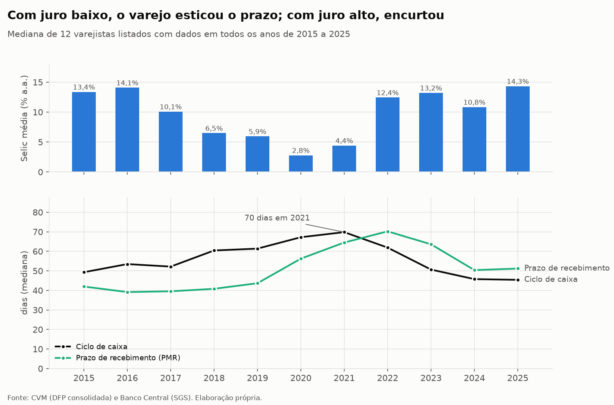
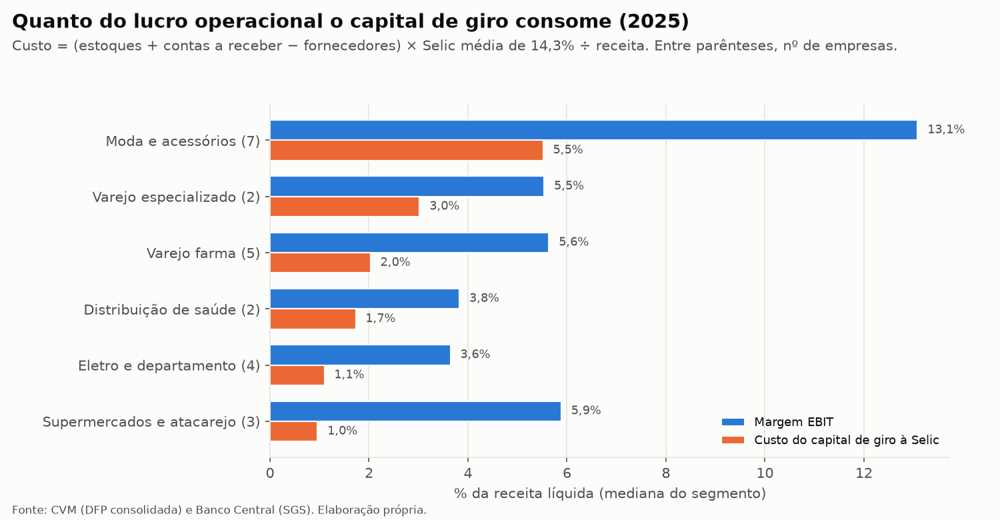

# Benchmark de capital de giro do varejo listado

Pipeline em **Python + DuckDB** que baixa as demonstrações financeiras públicas da **CVM** e indicadores do **Banco Central**, confere a qualidade dos dados e compara o ciclo de caixa e as margens de 24 varejistas da bolsa entre 2015 e 2025.

A pergunta de controladoria por trás do projeto: **quanto do lucro operacional o capital de giro consome quando o juro sobe?**



## O que os dados mostram

**1. O prazo de recebimento acompanhou o juro.** Num painel fixo de 12 varejistas com dados em todos os anos, o ciclo de caixa mediano subiu de 49 dias (2015) para 70 dias (2021), enquanto a Selic caía até 2,8%. Com a volta do juro alto, ele caiu para 45 dias em 2025. A maior parte do movimento veio do prazo de recebimento, que foi de 42 para 70 dias e voltou para 51.



> Os dados mostram que as duas coisas andaram juntas, não que uma causou a outra. A pandemia (2020–21) também alongou prazos: houve mais venda parcelada e mais comércio eletrônico.

**2. Em moda, o capital de giro custa quase metade da margem.** Um ciclo mediano de 167 dias, financiado à Selic média de 14,3% de 2025, custa 5,5% da receita. A margem EBIT mediana do segmento é de 13,1%. Em supermercados, o mesmo custo é de 1,0% da receita, porque o fornecedor financia boa parte do estoque.



**3. O modelo de negócio pesa mais que o segmento.**
- **Dentro de moda:** a C&A opera com ciclo negativo (−10 dias), porque paga o fornecedor depois de receber do cliente. Riachuelo (211 dias) e Renner (168 dias) carregam o crediário dos próprios cartões.
- **Em eletro:** o Magazine Luiza tem ciclo de 7 dias. A Quero-Quero tem 190 dias, e o custo de carregar esse giro (7,3% da receita) passa da margem EBIT (0,5%).

**4. Distribuição de saúde:** a CM Hospitalar (57 dias) e a Profarma (27 dias) trabalham com margens EBIT de 3% a 5%. Num setor de margem fina, cada dia de ciclo pesa.

## Como funciona

```
dados.cvm.gov.br (DFP, 1 zip por ano)  ─┐
api.bcb.gov.br (IPCA, Selic)           ─┤→ dados/brutos/ → DuckDB → sql/01…05 → resultados/*.csv + docs/*.png
config/empresas.csv (segmentos)        ─┘
```

| Etapa | Arquivo | O que faz |
|---|---|---|
| Extração | `src/benchmark/fontes.py` | Baixa as DFPs de 2015 a 2025 e as séries do BCB, com cache local. |
| Carga | `src/benchmark/carga.py` | Lê cerca de 1,9 milhão de linhas brutas no DuckDB, sem transformar nada. |
| Contas | `sql/01_contas.sql` | Filtra as empresas e contas usadas, converte "MIL"/"UNIDADE" para reais e fica com a versão mais recente de cada documento. |
| Indicadores | `sql/02_indicadores.sql` | Margens, PME, PMR, PMP e ciclo de caixa com **saldos médios** (o saldo inicial vem do mesmo documento). |
| Macro | `sql/03_macro.sql` | IPCA acumulado (para valores a preços constantes) e Selic média do ano. |
| Qualidade | `sql/04_qualidade.sql` | Conferências registradas em `resultados/qualidade.csv` (ver abaixo). |
| Segmentos | `sql/05_segmentos.sql` | Crescimento real, custo do capital de giro e medianas por segmento. |

### Conferências de qualidade

Antes de mostrar qualquer número, o pipeline confere os dados:

| Regra | Efeito |
|---|---|
| Conta essencial ausente (receita, CMV, estoques, contas a receber, fornecedores) | sai das medianas |
| DRE não fecha: receita − CMV ≠ resultado bruto (tolerância de 1%) | sai das medianas |
| Balanço não fecha: ativo ≠ passivo + PL (tolerância de 0,5%) | sai das medianas |
| Margem bruta fora de 0–100% | sai das medianas |
| Ciclo acima de 365 ou abaixo de −180 dias | só registra (a Vivara, joalheria, tem estoque longo por natureza) |
| Receita real variando mais de ±40% no ano | sai só da mediana de crescimento (cisão, aquisição) |
| Reapresentação / valores em reais em vez de milhares | só registra |

Na base atual, as 214 combinações de empresa e ano passam nas regras que excluem. A tabela de qualidade lista 80 registros informativos, incluindo a fusão Americanas + B2W (2021) e a cisão do Assaí no GPA (2022).

## Como rodar

```bash
pip install -r requirements.txt
python -m src.benchmark.pipeline           # baixa ~150 MB na primeira vez
python -m pytest                           # 10 testes com dados sintéticos
```

Para mudar o grupo de empresas, edite `config/empresas.csv` (código CVM, nome e segmento).

## Limitações

- **Segmentos definidos à mão.** O setor "Comércio" da CVM mistura farmácias, shoppings e distribuidoras de combustível. Os 6 segmentos daqui são uma classificação própria, e alguns têm só 2 empresas.
- **Braço financeiro.** Riachuelo, Renner e Quero-Quero têm cartão ou crediário próprio. As contas a receber incluem esse crédito, o que alonga o PMR e mistura receita financeira na margem.
- **Indicadores anuais.** Saldos médios de início e fim de ano escondem a sazonalidade, como o estoque alto antes do Natal.
- **PMR sobre receita líquida.** A receita bruta não está na DFP padronizada, então o prazo fica um pouco superestimado.
- **Custo do giro é simplificação.** Usa a Selic como custo de oportunidade. O custo real de captação de cada empresa é diferente.
- **Regra de perímetro é heurística.** Ela também marca crescimento orgânico forte, como o Magazine Luiza em 2020 e o Grupo Mateus em 2020.

## Dados

- CVM, [Dados Abertos: DFP de companhias abertas](https://dados.cvm.gov.br/dataset/cia_aberta-doc-dfp) (demonstrações consolidadas).
- Banco Central, SGS: série 433 (IPCA mensal) e 4189 (Selic acumulada no mês, anualizada).

Os arquivos brutos não entram no repositório: são baixados pelo pipeline. Os resultados calculados ficam em `resultados/`.
